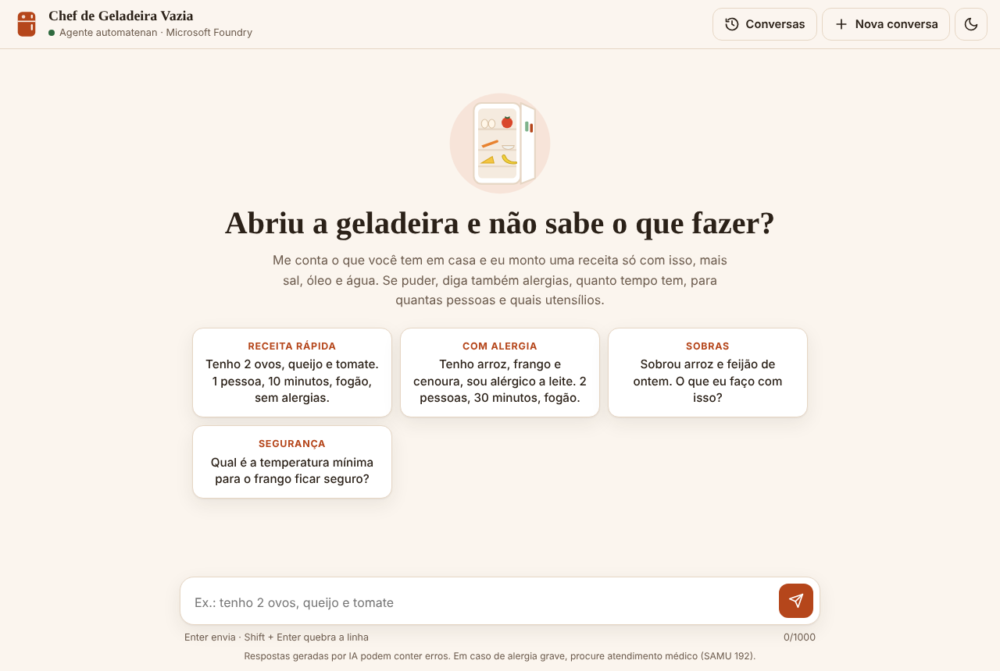
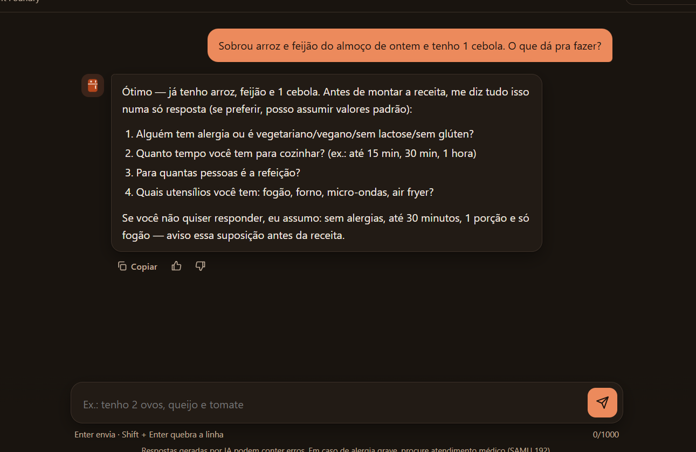
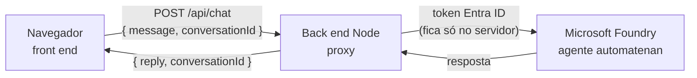

# Chef de Geladeira Vazia · interface web do agente no Microsoft Foundry

Aplicação web de chat para o agente **Chef de Geladeira Vazia** (no Foundry: `automatenan`). O agente cria receitas só com os ingredientes que a pessoa já tem em casa, mais sal, óleo e água, para economizar dinheiro e tempo e reduzir o desperdício de comida.

**Público:** estudantes e pessoas que moram sozinhas, quem tem pouco tempo ou pouca experiência na cozinha e famílias que querem aproveitar sobras.

Todas as respostas exibidas vêm do agente publicado no Microsoft Foundry, chamado pelo back end deste projeto.



Conversa real com o agente `automatenan` no Foundry (ele pergunta restrições, tempo, porções e utensílios antes de montar a receita, como mandam as instruções do agente):



## Arquitetura



1. O navegador envia a mensagem para o **nosso** back end (`POST /api/chat`). O front end não conhece o endpoint do Foundry e não tem nenhuma chave.
2. O back end valida a mensagem (texto, não vazia, até 1000 caracteres) e pega um token do **Microsoft Entra ID** com o `DefaultAzureCredential` (escopo `https://ai.azure.com/.default`).
3. Na primeira mensagem, o back end cria uma conversa no Foundry (`POST {endpoint}/openai/v1/conversations`) e devolve o `conversationId` ao navegador.
4. Cada mensagem vai para o agente pela Responses API (`POST {endpoint}/openai/v1/responses`), com a referência ao agente (`"agent_reference": { "type": "agent_reference", "name": "automatenan" }`) e o mesmo `conversationId`. É isso que mantém o contexto entre as mensagens (multi-turno).
5. O botão **Nova conversa** descarta o `conversationId`, e a próxima mensagem cria outra conversa.

| Componente | Responsabilidade |
| --- | --- |
| Front end (`public/`) | Chat, carregamento, erros, nova conversa, histórico, tema, exibição das respostas em markdown |
| Back end (`server/`) | Variáveis de ambiente, autenticação no Foundry, chamada ao agente, validação, limites, tratamento de erros |
| Microsoft Foundry | Executa o agente `automatenan` (modelo `gpt-5-mini`) com as instruções e a base de conhecimento |

## Funcionalidades

| Requisito | Como foi atendido |
| --- | --- |
| RF1 Tela de chat | Campo de mensagem, botão de envio e histórico com as mensagens do usuário e do agente |
| RF2 Integração real | `server/foundry.js` chama o agente no Foundry pelo back end |
| RF3 Multi-turno | `conversationId` criado uma vez e reutilizado a cada mensagem |
| RF4 Carregamento | "O Chef está pensando…" e, depois de 12 s, aviso de que está demorando |
| RF5 Erros amigáveis | Agente indisponível (503), demora excessiva (504), falha de rede (502), limite de uso (429), sem internet; botão "Tentar de novo" |
| RF6 Nova conversa | Botão no topo |
| RF7 Responsivo | Testado em celular (390 px) e computador (1280 px) |
| RF8 Identidade visual | Nome, cores terracota, ilustração e boas-vindas do Chef |
| Extras | Markdown nas respostas, sugestões clicáveis, histórico de conversas, 👍/👎 por resposta, modo escuro, botão copiar |

## Pré-requisitos

- **Node.js 20** ou mais novo: https://nodejs.org
- **Azure CLI**: https://learn.microsoft.com/cli/azure/install-azure-cli
- Uma conta com acesso ao projeto do Foundry. Para chamar o agente por código, a conta precisa do papel **Azure AI User** (ou superior) no projeto.

## Como instalar e executar

1. Instale as dependências:
   ```
   npm install
   ```
2. Faça login no Azure com a mesma conta do Foundry:
   ```
   az login
   ```
3. Copie o `.env.example` para `.env` e preencha (veja a próxima seção).
4. Rode:
   ```
   npm start
   ```
5. Abra **http://localhost:3000**.

No Windows, depois dos passos 2 e 3, também dá para dar dois cliques em `iniciar.bat`: ele instala as dependências, sobe o servidor e abre o navegador.

## Variáveis de ambiente

| Variável | Obrigatória | Para que serve |
| --- | --- | --- |
| `FOUNDRY_PROJECT_ENDPOINT` | Sim | Endpoint do projeto no Foundry, no formato `https://<recurso>.services.ai.azure.com/api/projects/<projeto>`. Fica na página inicial do projeto no portal |
| `FOUNDRY_AGENT_NAME` | Sim | Nome do agente no Foundry |
| `FOUNDRY_AGENT_VERSION` | Não | Fixa uma versão do agente; vazio usa a mais recente |
| `PORT` | Não | Porta do servidor (padrão 3000) |
| `AGENT_TIMEOUT_MS` | Não | Tempo máximo esperando o agente (padrão 60000) |
| `MAX_MESSAGE_LENGTH` | Não | Tamanho máximo da mensagem (padrão 1000) |
| `RATE_LIMIT_PER_MINUTE` | Não | Mensagens por minuto por usuário (padrão 20) |
| `AZURE_TENANT_ID`, `AZURE_CLIENT_ID`, `AZURE_CLIENT_SECRET` | Só para publicar | Login por service principal quando a aplicação roda num servidor online, sem `az login` |

## Testes

```
npm test
```

São 19 testes automáticos do back end. Eles usam um **Foundry falso** (`tests/mock-foundry.js`) só para conferir o comportamento do servidor sem gastar cota: validação, multi-turno, conversa expirada, demora, erros do agente, falha de rede, falta de login, limite de uso, formato antigo do Foundry, privacidade dos logs, cabeçalhos de segurança e ausência de segredos no front end. A aplicação em si sempre fala com o Foundry de verdade.

## Diagnóstico da conexão

Se o chat mostrar "O Chef está indisponível", o motivo real aparece no terminal do servidor (linha `[agente] falha: ...`). Para testar a conexão com o Foundry passo a passo, rode:

```
node diagnostico.js
```

Ele mostra a conta do Azure usada, cria uma conversa e testa os formatos de chamada ao agente, exibindo a resposta completa do Foundry em cada um (sem mostrar o token).

## Estrutura de pastas

```
├── public/                 front end (servido pelo back end)
│   ├── index.html
│   ├── css/style.css
│   ├── img/                ícone e ilustração
│   └── js/
│       ├── app.js          chat, histórico, erros, tema
│       ├── markdown.js     markdown seguro (escapa HTML antes)
│       └── theme.js        aplica o tema salvo
├── server/
│   ├── app.js              rotas /api/chat, /api/health, /api/feedback e arquivos estáticos
│   ├── foundry.js          token do Entra ID, conversas e Responses API
│   ├── validate.js         validação da mensagem
│   └── config.js           leitura do .env
├── tests/                  testes do back end e Foundry falso
├── docs/                   imagens do README
├── server.js               ponto de entrada (npm start)
├── diagnostico.js          teste da conexão com o Foundry
├── .env.example
└── iniciar.bat
```

## Decisões técnicas

- **Credenciais só no servidor.** O front end conversa apenas com `/api/chat`. Não há endpoint, token ou chave em nenhum arquivo de `public/` (um teste confere isso).
- **Sem chave no `.env` para rodar no PC.** O `DefaultAzureCredential` usa o login do `az login`, então nem o `.env` guarda segredo. Para publicar, o login passa a ser por service principal, configurado nas variáveis do serviço de hospedagem, nunca no código.
- **Servidor com o Node puro (`http`).** Uma dependência só (`@azure/identity`), menos coisa para instalar e para explicar.
- **Chamada REST em vez do SDK do projeto.** As rotas `/openai/v1/conversations` e `/openai/v1/responses` deixam explícito o que acontece em cada passo.
- **Token em cache.** O token é reaproveitado até 5 minutos antes de expirar, para não pedir um novo a cada mensagem.
- **Erros sem detalhes técnicos para o usuário.** O detalhe vai só para o log do servidor.
- **Privacidade.** Os logs registram só método, rota, status e tempo; nunca o texto das mensagens. O histórico de conversas fica só no navegador de quem usa. O 👍/👎 envia só o voto, sem o conteúdo.
- **Custos.** Modelo `gpt-5-mini`, limite de 20 mensagens por minuto por usuário e de 1000 caracteres por mensagem.
- **Segurança da página.** Content-Security-Policy restrita (só scripts e estilos do próprio site), o markdown escapa todo HTML antes de formatar e o servidor bloqueia acesso a arquivos fora de `public/`.
- **Formato da chamada ao agente.** A documentação do Foundry mudou durante o projeto: o campo antigo `agent` passou a ser `agent_reference`. O back end usa o formato atual e, se o Foundry recusar com erro 400, tenta o outro uma vez e lembra qual funcionou.
- **Conversa expirada.** Se o Foundry não encontrar a conversa salva no navegador, o back end começa outra e avisa o usuário.

## Limitações conhecidas

- A resposta aparece de uma vez (sem streaming).
- O histórico de conversas fica salvo só no navegador; em outro aparelho ele não aparece.
- O limite de mensagens por minuto fica na memória do servidor e zera quando ele reinicia.

## Créditos e referências

- [@azure/identity](https://www.npmjs.com/package/@azure/identity) (Microsoft): autenticação no Entra ID.
- Documentação do Microsoft Foundry: [quickstart de agentes](https://learn.microsoft.com/azure/foundry/agents/quickstarts/prompt-agent) e [exemplos REST de Responses e Conversations](https://learn.microsoft.com/azure/foundry/agents/how-to/tools/function-calling).
- Desenvolvido com apoio de IA (Claude, da Anthropic), conforme descrito no documento do processo.
